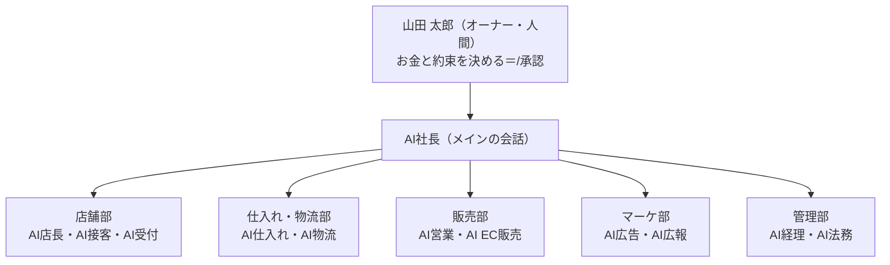

# やまだ商店 AI経営（架空のサンプル企業）

**ここに出てくる会社・人・お客様・数字は、全部架空です。** 株式会社やまだ商店は実在しません。住所（〒000-0000 兵庫県△△市□□町1-2-3）と電話（000-000-0000）も架空の印です。

兵庫県の町のお店「やまだ商店」を、**人間のオーナー1人＋AI社長＋11部の AI**（Claude Code のサブエージェント）で **1日ずつ動かす** 会社のシミュレーションです。
AI が数字を見て提案を書き、人が承認すると会社に効果が入り、1日進めると数字が動きます。YouTube「AI道場」の「いつもの会社」として回をまたいで使います。

## 組織図



- 事業は5つ：店舗（食料品・日用品・酒類）・配達（電話注文）・EC（地酒・地ビール）・法人（飲食店・介護施設）・ギフト（お歳暮・お中元）。年商 約5,800万円・粗利率 約30%・人は8人。くわしくは [company/](company/)。

## 会社の1日（運用のサイクル）

```
/朝会 ──→ /承認待ち ──→ /承認 <ID>（または /却下 <ID> <理由>）──→ /一日進める ──→ /朝会 …
 AI が見て提案を書く     人が見る         人が決める・会社に効果が入る          会社が動く・数字が変わる
```

## はじめかた

```bash
cd "$HOME/Yamada -shoten/yamada-shoten-ai"
python3 tools/sim.py init
claude
```

`init` ははじめの状態（**2026-11-10（火）の朝**・データは昨日まで）に戻します。撮り直しで承認の箱と意思決定ログも空にするなら `python3 tools/sim.py init --clean`。

## コマンド

| コマンド | すること | 人／AI |
|---|---|---|
| `やまだ商店の売上どうやった？` | AI社長が店長・仕入れ・経理・EC販売に並列で聞いて、全社の報告（承認待ちは上位5件） | AI |
| `/朝会` | 毎朝の会議。全体・事業別・各部の気づき・今日やること3つ・承認待ち上位5件を reports/ に保存 | AI |
| `/朝のレポート` | AI を呼ばない1分の短い版 | AI |
| `/経営会議` | 毎週月曜。KPI と目標・11部・来週の重点3つ | AI |
| `/月次決算` | 毎月初。月次PL・予算比・前年比・資金繰り | AI |
| `/承認待ち` | 提案の一覧（期限が近い順 → 金額が大きい順） | 人 |
| `/承認 <ID>` | 承認 → approved/ へ・意思決定ログ・会社に効果（`sim.py apply`） | **人** |
| `/却下 <ID> <理由>` | 却下 → rejected/ へ・意思決定ログ | **人** |
| `/一日進める [N]` | 会社を N 日進めて、何が起きたかを短く | **人** |
| `/ダッシュボード` | reports/dashboard.html と dashboard_data.json を作って開く（動画に映せる1枚・数字ごとの出どころつき） | 人 |

ターミナルから直接：`python3 tools/sim.py status`（今の会社を10行）・`python3 tools/q.py 一覧`（数字の早見）。

## 5分のデモの台本（撮影用）

撮る前（ターミナル）：
```bash
cd "$HOME/Yamada -shoten/yamada-shoten-ai"
python3 tools/sim.py init --clean
python3 tools/sim.py status
claude
```
撮る（Claude Code の中で、この順に打つ）：
1. `やまだ商店の売上どうやった？` → 4部が並列で動く（3〜5分）。酒類が約3割落ちた・播磨ゴールドが5日前から在庫0・秋祭りに間に合う発注は今日15時が最後・居酒屋の入金が41日遅れ。承認待ちの上位5件が出る。
2. `/承認待ち` → 表。播磨ゴールドの発注（AI仕入れ・ID は 20261110-251 から）が一番上。
3. `/承認 20261110-251`（表の ID をそのまま）→「発注：播磨ゴールド（350ml×6缶パック） 80パック（入荷予定 11/13（金））」。
4. `/一日進める 3` → 11/10〜11/12 は欠品のまま、最後に「11/13（金）の朝：［入荷］播磨ゴールド（350ml×6缶パック） 80パック・［出荷］ネットの待っていた注文 8件」。
5. `/一日進める 2` → 11/13（金）酒類が戻る（1日 約1.6万円 → 約3.3万円）・11/14（土）秋祭りで酒類 約11.8万円。11/15 の朝に在庫0なのはティッシュだけ（日用品の手配の提案を承認していないため）。
6. `/ダッシュボード` → 酒類の線が落ちて、戻って、祭りで跳ねる。

承認しないで `/一日進める 5` すると、祭りの日も播磨ゴールドが無く、酒類は約5.2万円止まり・「屋台で取り逃がし 約7.2万円」と出る（比べると分かりやすい）。

## データの出どころ（シミュレーション）

スマレジ（POS）・自社サイト（Shopify）・楽天市場・Amazon・Google アナリティクス 4・Google 広告・Meta 広告・freee 会計／請求書・マネーフォワード クラウド経費・ネットバンキング・Google ビジネスプロフィール・Instagram・LINE 公式アカウント・社内の台帳や PDF など23の出どころから取り込む「ことにしています」。**どれにも実際にはつないでいません**。一覧と図は [company/データマップ.md](company/データマップ.md)、機械が読む版は `data/_sources.json`。

## 毎日の数字はどう動くか

`tools/sim.py` が会社を動かします（決まりは [sim/ルール.md](sim/ルール.md)）。在庫が無ければ売れない・発注は納期のあとに入荷・祭りの日は酒類が約2倍・雨の日は配達が増える・期日・入金・月末の締め、まで。乱数の種は日付なので、同じ状態から同じ日を進めれば毎回同じ結果です。

## フォルダ

| フォルダ・ファイル | 中身 |
|---|---|
| `CLAUDE.md` | AI社長の運営マニュアル（Claude Code が最初に読む） |
| `company/` | 会社概要・組織図・事業・決裁ルール・商品と価格の考え方・KPI・**データマップ**（どのデータがどのサービスから来るか・全部シミュレーション） |
| `knowledge/` | 部ごとの判断の基準（手順・チェックリスト・数字の式）と承認の書き方 |
| `data/` | 経営データ（全部架空・書くのは sim.py だけ・読むだけの設定）。説明は `data/README.md` |
| `sim/` | 会社の今の状態 `state.json`・前年の参照・`ルール.md` |
| `approvals/` | 提案の箱：`pending/`（承認待ち）・`approved/`・`rejected/`・`テンプレート.md` |
| `logs/` | `意思決定ログ.md`（承認と却下の記録） |
| `reports/` | 朝会・経営会議・月次決算・ダッシュボード（`dashboard.html` と、数字と出どころの `dashboard_data.json`） |
| `docs/` | 何ができるかのまとめ |
| `.claude/` | `settings.json`（守り）・`agents/`（AI社長＋11部）・`commands/`（上の表のコマンド） |
| `tools/` | `sources.py`（データの出どころの一覧）・`sim.py`（シミュレーション）・`q.py`（数字の早見・読むだけ）・`approvals.py`（承認）・`dashboard.py`・`make_data.py`（前の版の入口）・`仕込み一覧.md`（ネタバレ） |
| `tests/` | テスト（`python3 tests/run_tests.py`・30秒以内） |
| `ops/launchd/` | 毎朝7時に /朝会 を回すひな形（まだ入れていない） |

## 守り

- **AI は承認しない・会社を進めない**。`approvals.py approve`・`sim.py advance`・`sim.py apply` は settings で許しておらず、人が打つ `/承認`・`/却下`・`/一日進める` のときだけ動く（コマンドの `allowed-tools`）。
- AI が書いてよいのは `reports/`・`approvals/pending/`・`logs/`（意思決定ログ以外）だけ。`data/`・`company/`・`knowledge/`・`sim/`・`tools/` と `approved/`・`rejected/` は Edit を止めている（Claude Code では `Edit(...)` が Write にも効く）。
- **data/ と sim/state.json は「読むだけ」**（ファイルもフォルダも書き込み不可）。`sim.py` が書くときだけ外して、書き終わったら戻す。AI が Python で data/ に書こうとしても PermissionError で失敗する（テストで確かめている）。手で直したいときは `chmod -R u+w data`（ふつうは `python3 tools/sim.py init` で作り直す）。
- `rm` と `git push` は止めている。`tools/仕込み一覧.md`（ネタバレ）は AI から読めない。

## テスト

```bash
python3 tests/run_tests.py
```
pytest が入っていれば `python3 -m pytest tests` でも動く。中身：数字のそろい（POS＝月次PL・日計表＝月次PL・法人・広告・現金の足し算）・はじめの日の仕込み・一日進めるの再現性と在庫がマイナスにならないこと・月末の締め・承認していないものは入らないこと・播磨ゴールドの発注で欠品が直ること・エージェントとコマンドの書き方・settings の守り・data の鍵。

## 毎朝7時に自動で朝会（入れるときだけ）

```bash
cd "$HOME/Yamada -shoten/yamada-shoten-ai"
sed "s|REPO_PATH|$PWD|g" ops/launchd/com.yamada-shoten.asakai.plist.template > ~/Library/LaunchAgents/com.yamada-shoten.asakai.plist
launchctl load ~/Library/LaunchAgents/com.yamada-shoten.asakai.plist
```
月〜土の7時に `claude -p "/朝会"` が動き、`reports/YYYYMMDD_朝会.md` ができる（記録は `logs/朝会_自動.log`）。会社は自動では進まない（`/一日進める` は人が打つ）。やめるときは `launchctl unload ~/Library/LaunchAgents/com.yamada-shoten.asakai.plist`。

## 仕込んである話

各部に1つずつ、データの中に「気づいてほしい話」を入れてあり、承認すると直せます（欠品の発注・督促・契約の申し出・お知らせの掲載・在庫連動・電話番・配達の便…）。中身は [tools/仕込み一覧.md](tools/仕込み一覧.md)（人間向けのネタバレ）。

## 次の回で使うとき

- 会社の設定（人・商品・数字）を変えるときは `tools/sim_model.py` と `company/` を正にして、ほかを合わせる。人の名前は `company/組織図.md` と `tools/sim_model.py` の STAFF だけ。
- 新しい AI の役を足すときは `.claude/agents/` と `knowledge/<部>/` に1つずつ足し、CLAUDE.md と company/組織図.md の表に1行足す。
- 実演の対象はこの架空の会社だけ。本物の会社・サイトには使わない。
