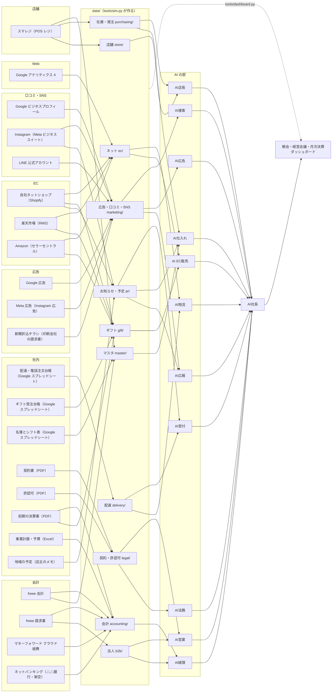

# データマップ（どのデータが、どこから来るか）

※**全部シミュレーションです。** やまだ商店は架空のサンプル企業で、下のサービスには **実際にはつないでいません**。
data/ のファイルは `tools/sim.py` が作っています。この表は「本物の会社なら、どのサービスからどう取り込むか」の対応です。
機械が読む版は `data/_sources.json`（sim.py init が書く）。元は `tools/sources.py`。ダッシュボードの数字ごとの出どころは `reports/dashboard_data.json` の `kpis[].sources`。

## つながり（サービス → data/ → AI → 報告）

## サービスの一覧（23）

| id | サービス | 分類 | 何のデータ | 取り込み方 | 頻度 | data/ のファイル | 使う AI |
|---|---|---|---|---|---|---|---|
| `smaregi` | スマレジ（POS レジ） | 店舗 | 店の売上・客数・客単価・品目ごとの売れ数・在庫・発注 | API | 毎晩 | `store/POS_日別.csv` `store/POS_商品別_直近14日.csv` `purchasing/在庫.csv` `purchasing/発注履歴.csv` `master/商品.csv` | AI店長・AI仕入れ |
| `shopify` | 自社ネットショップ（Shopify） | EC | 自社サイトの注文・商品ページ・のしギフト・サイトのお知らせ | API | 毎晩 | `ec/注文_日別.csv` `ec/チャネル別_日別.csv` `ec/注文_商品別_直近28日.csv` `ec/商品ページ.csv` `gift/ギフト受注_日別.csv` `pr/お知らせ.md` | AI EC販売・AI物流・AI広報 |
| `rakuten` | 楽天市場（RMS） | EC | 楽天の店の注文・手数料・ギフトの注文 | CSV書き出し | 毎朝 | `ec/注文_日別.csv` `ec/チャネル別_日別.csv` `ec/注文_商品別_直近28日.csv` `ec/商品ページ.csv` `gift/ギフト受注_日別.csv` | AI EC販売 |
| `amazon` | Amazon（セラーセントラル） | EC | Amazon の注文・手数料・ギフトの注文 | API | 毎晩 | `ec/注文_日別.csv` `ec/チャネル別_日別.csv` `ec/注文_商品別_直近28日.csv` `ec/商品ページ.csv` `gift/ギフト受注_日別.csv` | AI EC販売 |
| `ga4` | Google アナリティクス 4 | Web | ネットショップの訪問（セッション）・流入元・購入率 | API | 毎朝 | `ec/注文_日別.csv` `ec/商品ページ.csv` | AI EC販売・AI広告 |
| `google_ads` | Google 広告 | 広告 | 検索広告の費用・表示・クリック・反応からの売上 | API | 毎朝 | `marketing/広告.csv` | AI広告 |
| `meta_ads` | Meta 広告（Instagram 広告） | 広告 | Instagram 広告の費用・表示・クリック・反応からの売上 | API | 毎朝 | `marketing/広告.csv` | AI広告 |
| `flyer_invoice` | 新聞折込チラシ（印刷会社の請求書） | 広告 | チラシの費用・配った部数・クーポンの回収 | 手入力 | 月次 | `marketing/広告.csv` | AI広告・AI経理 |
| `freee_accounting` | freee 会計 | 会計 | 仕訳・毎日の帳簿・月次の損益・売掛金・買掛金・取引先 | API | 毎晩 | `accounting/日計表.csv` `accounting/月次PL.csv` `accounting/売掛金.csv` `accounting/買掛金.csv` `master/仕入先.csv` `master/法人顧客.csv` | AI経理・AI社長 |
| `freee_invoice` | freee 請求書 | 会計 | 法人への納品と請求書 | API | 毎晩 | `b2b/納品_日別.csv` `b2b/法人売上_月別.csv` `accounting/売掛金.csv` | AI営業・AI経理 |
| `mf_expense` | マネーフォワード クラウド経費 | 会計 | 経費の精算（ガソリン・消耗品・立て替え） | CSV書き出し | 毎週 | `accounting/月次PL.csv` | AI経理 |
| `netbank` | ネットバンキング（△△銀行・架空） | 会計 | 口座の入金・出金・残高 | CSV書き出し | 毎朝 | `accounting/日計表.csv` `accounting/資金繰り.csv` `accounting/売掛金.csv` | AI経理 |
| `gbp` | Google ビジネスプロフィール | 口コミ・SNS | 地図の口コミ・電話と道順のタップ | API | 毎朝 | `marketing/口コミ.csv` `marketing/広告.csv` | AI接客・AI広報 |
| `instagram` | Instagram（Meta ビジネススイート） | 口コミ・SNS | 投稿・リーチ・フォロワー・お知らせの投稿 | API | 毎週 | `marketing/SNS.csv` `pr/お知らせ.md` | AI広報・AI広告 |
| `line_oa` | LINE 公式アカウント | 口コミ・SNS | 友だちの数・配信・開封・クーポンの利用 | CSV書き出し | 毎週 | `marketing/LINE.csv` | AI広報 |
| `delivery_sheet` | 配達・電話注文台帳（Google スプレッドシート） | 社内 | 電話の着信・取れなかった電話・配達の件数・地区・便・時間 | 手入力 | 毎晩 | `delivery/配達_日別.csv` | AI受付・AI物流 |
| `gift_sheet` | ギフト受注台帳（Google スプレッドシート） | 社内 | 店頭・電話・法人のお歳暮・お中元の承り | 手入力 | 毎晩 | `gift/ギフト受注_日別.csv` `gift/ギフト受注_週別.csv` | AI EC販売 |
| `staff_sheet` | 名簿とシフト表（Google スプレッドシート） | 社内 | 人の役割・勤務の時間 | 手入力 | 月次 | `master/従業員.csv` | AI店長・AI社長 |
| `contracts_pdf` | 契約書（PDF） | 社内 | 契約の相手・期間・更新日・申し出期限・条項 | PDF読み取り | 月次 | `legal/契約.csv` | AI法務・AI営業 |
| `licenses_pdf` | 許認可（PDF） | 社内 | 酒類の免許・営業許可・研修の期限 | PDF読み取り | 月次 | `legal/許認可.csv` | AI法務 |
| `kessansho_pdf` | 前期の決算書（PDF） | 社内 | 去年の月ごとの売上と損益（前年比のもと） | PDF読み取り | 月次 | `accounting/月次PL.csv` `gift/ギフト受注_週別.csv` | AI経理・AI社長 |
| `budget_excel` | 事業計画・予算（Excel） | 社内 | 今年度の月ごと・事業ごとの予算 | CSV書き出し | 月次 | `accounting/予算.csv` | AI経理・AI社長 |
| `owner_memo` | 地域の予定（店主のメモ） | 社内 | 町の行事・屋台・天気の見通し | 手入力 | 毎週 | `pr/地域の予定.md` | AI広報・AI仕入れ・AI受付 |

## 取り込み方と頻度の目安

| 取り込み方 | 意味 | 例 |
|---|---|---|
| API | サービスのつなぎ口から自動で取る | スマレジ・Shopify・Amazon・freee・Google・Meta |
| CSV書き出し | 管理画面から CSV を書き出して読む | 楽天 RMS・マネーフォワード・ネットバンキング・LINE・予算の Excel |
| 手入力 | 人が台帳やスプレッドシートに書く | 配達・電話注文台帳・ギフト受注台帳・名簿・チラシの請求書・店主のメモ |
| PDF読み取り | PDF の書類から読み取る | 契約書・許認可・前期の決算書 |

- 毎晩：その日の売上・注文・帳簿。毎朝：広告・Web・口コミ・銀行。毎週：SNS・LINE・経費・店主のメモ。月次：請求書・契約・決算書・予算。

## ネットの3店（自社サイト・楽天市場・Amazon）

| 店 | 出どころ | 注文の割合（通常） | ギフトの割合 | 手数料の目安 |
|---|---|---|---|---|
| 自社サイト | `shopify` | 約45% | 約55% | 約3.6%（決済） |
| 楽天市場 | `rakuten` | 約35% | 約30% | 約9.5%（出店料・システム利用料・決済） |
| Amazon | `amazon` | 約20% | 約15% | 約10%（販売手数料） |

- 日ごとの数字は `data/ec/チャネル別_日別.csv`。月次PL の「支払手数料」＝店のカード手数料（売上の0.6%）＋この3店の手数料。
- 手数料率とシェアは架空の目安です。
