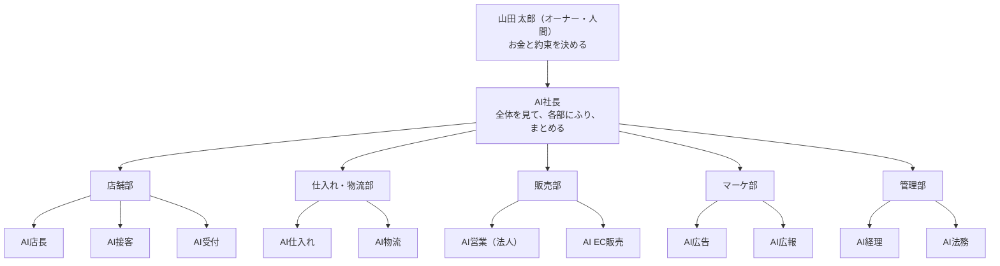

# 組織図（人と AI）

※架空のサンプル企業です。人の名前も架空です。

## 部と AI（いつ誰を呼ぶか）

| 部 | AI | エージェント名 | 受け持ち |
|---|---|---|---|
| ― | AI社長 | `ai-shacho`（ふだんはメインの会話） | 全体のまとめ・各部へのふり分け・今日やること3つ・承認のお願い |
| 店舗部 | AI店長 | `ai-tencho` | 店の売上・客数・商品の動き・欠品・売場 |
| 店舗部 | AI接客 | `ai-sekkyaku` | 口コミ・お客様の声・レジの混雑・返信の下書き |
| 店舗部 | AI受付 | `ai-uketsuke` | 電話・メール・注文の受付と、どの部に回すか |
| 仕入れ・物流部 | AI仕入れ | `ai-shiire` | 在庫・発注の期限・発注案 |
| 仕入れ・物流部 | AI物流 | `ai-butsuryu` | 配達のルートと便・ネットとギフトの出荷 |
| 販売部 | AI営業 | `ai-eigyo` | 法人（飲食店・介護施設）の売上と提案 |
| 販売部 | AI EC販売 | `ai-ec` | ネットショップ・ギフト・サイトの在庫表示 |
| マーケ部 | AI広告 | `ai-koukoku` | 広告の費用と効果・予算の配り方 |
| マーケ部 | AI広報 | `ai-kouhou` | お知らせ・Instagram・地域の行事の告知 |
| 管理部 | AI経理 | `ai-keiri` | 損益・売掛金・買掛金・資金繰り |
| 管理部 | AI法務 | `ai-houmu` | 契約の更新・免許・お酒の表示・個人情報・景表法 |

## 人と AI の分担

| 人（架空） | 役職 | 主な仕事 | 一緒に動く AI | 人がやること | AI がやること |
|---|---|---|---|---|---|
| 山田 太郎 | 代表取締役（三代目店主） | 最後の判断・仕入れの目利き・お酒 | AI社長 | 承認・発注・取引先との話 | 全体の報告・承認の一覧 |
| 山田 恵子 | 専務取締役 | 経理・総務・ギフトの受付 | AI経理・AI法務 | 振り込み・催促の電話・契約の手続き | 数字の集計・期限の見張り・文面の下書き |
| 山田 健太 | 店長代理（四代目候補） | ネット・Instagram・法人の窓口 | AI EC販売・AI広告・AI広報・AI営業 | サイトの更新・投稿・取引先まわり | 数字の分析・下書き・提案の種 |
| 藤井 誠 | 配達・仕入れ（正社員） | 午前便・発注・品出し | AI仕入れ・AI物流 | 発注の電話・配達 | 発注案・ルート案 |
| 小林 学 | 配達（パート） | 午後便 | AI物流 | 配達 | 便の組み方の案 |
| 岡本 典子 | レジ・電話（パート） | 平日の朝〜昼のレジと電話 | AI受付・AI接客 | 電話に出る・レジ | 電話の混む日の予測 |
| 西川 美穂 | レジ（パート） | 夕方のレジ | AI接客 | レジ | 口コミのまとめ |
| 森田 由美 | 惣菜（パート） | 惣菜・お弁当（食品衛生責任者） | AI店長 | 調理 | 売れ数の予測 |

勤務の時間は `data/master/従業員.csv`。

## 決める人

- お金が動くこと・外への約束は **山田 太郎**。山田さんがいないときは **山田 恵子** が代わりに決める。
- くわしくは [決裁ルール.md](決裁ルール.md)。
